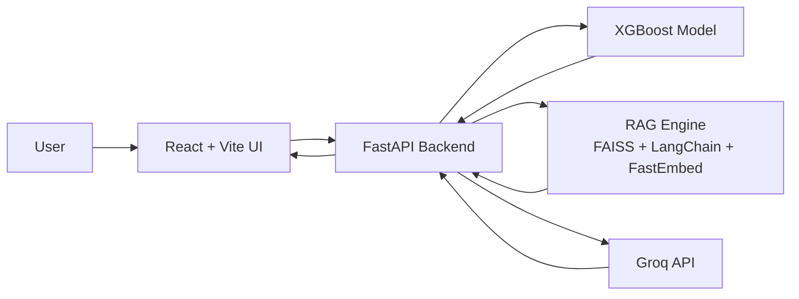

<div align="center">

# ⚡ EnergyIQ

### _Next-Gen Smart Energy Intelligence Platform powered by AI & RAG_

</div>

---

<div align="center">


</div>

---

## 🚀 Overview

**EnergyIQ** is a modern **AI-powered smart energy management platform** designed to:

- 📊 Predict household energy consumption
- 🧠 Deliver contextual insights via a **RAG-based AI chatbot**
- ⚡ Provide **ultra-fast inference using Groq API**
- 🐳 Run efficiently on **cloud free tiers (Render optimized)**

> 💡 _Built with performance, scalability, and cost-efficiency in mind._

---

## ✨ Key Features

- ⚡ **Energy Prediction Engine**  
  Advanced time-series forecasting using XGBoost & Scikit-Learn

- 🧠 **RAG-powered AI Assistant**  
  Context-aware chatbot using FAISS + LangChain + FastEmbed

- 🚀 **Ultra-fast LLM Inference**  
  Powered by **Groq API** for blazing-fast responses

- 📦 **Optimized Backend (10x smaller)**  
  Switched from PyTorch → ONNX + FastEmbed

- 🐳 **Cloud-Ready Docker Architecture**  
  Multi-stage builds for minimal image size

- 🌐 **Production-ready Frontend**  
  Built with Vite + React + Nginx

---

## 🏗️ Architecture


---
## 🧰 Tech Stack

| Category        | Technologies |
|----------------|-------------|
| **Frontend**   | Vite, React, Nginx |
| **Backend**    | FastAPI, Uvicorn, Pydantic |
| **ML Models**  | XGBoost, Scikit-Learn, Pandas |
| **RAG Engine** | FAISS, LangChain, FastEmbed |
| **LLM**        | Groq API |
| **DevOps**     | Docker, Docker Compose, Multi-stage Builds |
| **Deployment** | Render (Free Tier Optimized) |

---

## ⚙️ Local Setup

### 1️⃣ Clone the Repository

```bash
git clone https://github.com/DhawalThombare37/EnergyIQ.git
cd EnergyIQ
```
### 2️⃣ Configure Environment Variables

Create a .env file:
```
GROQ_API_KEY=your_api_key_here
```
💡 Tip: Keep your .env file out of version control using .gitignore

### 3️⃣ Run with Docker Compose
```
docker-compose up --build
```

### 4️⃣ Access the App
```
🌐 Frontend → http://localhost:3000
⚙️ Backend → http://localhost:8000
🐳 Deployment (Render Optimized)
```
### EnergyIQ is fully optimized for free-tier deployment.
--- 
## 🔥 Key Optimizations:
- Multi-stage Docker builds → reduced image size (~10x smaller)
- No local LLM → uses Groq API
- Lightweight embeddings → FastEmbed
---
## 🚀 Deploy on Render
- Push code to GitHub
- Create new Web Service on Render
- Connect repo
Use included:
```
render.yaml
```
⚡ Alternative: Railway
- Works for demo deployments
- Use Docker deployment
- Add environment variables in dashboard
---

## 📁 Project Structure
```
EnergyIQ/
│
├── frontend/        # React + Vite app
├── backend/         # FastAPI server
├── models/          # ML models (optimized)
├── rag/             # RAG pipeline
├── docker-compose.yml
├── render.yaml
└── README.md
```

## 🧠 Design Philosophy

“Build powerful AI systems that are efficient, deployable, and accessible.”
---
- ❌ Avoid heavy local models
- ✅ Use API-based inference
- ✅ Optimize for free-tier cloud
- ✅ Modular architecture
- 🚀 Future Enhancements
- 📊 Real-time smart meter integration
- 📱 Mobile app (React Native)
- 🔋 Energy optimization recommendations
- 🌍 Multi-region deployment
---
## 🤝 Contributing
Contributions are welcome!
fork → clone → create branch → commit → PR 🚀
---

## 📜 License

MIT License © 2026 EnergyIQ
---

<div align="center">
⭐ If you like this project, give it a star!
</div> 
